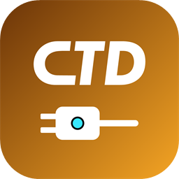

<p align="center">
  
</p>

<h1 align="center">CTD OBS Plugin</h1>

<p align="center"><b>Live SRT camera feeds in OBS that stay at the live edge for hours, fix themselves, and line up by timecode.</b></p>

<p align="center">
  <a href="#set-up-in-five-minutes">Set up</a> ·
  <a href="#install">Install</a> ·
  <a href="docs/api.md">API</a> ·
  <a href="#build">Build</a>
</p>

---

## What it does

- **CTD Live Source (SRT)** for feeds from [MediaMTX](https://github.com/bluenviron/mediamtx). It replaces the stock
  Media Source for phones, encoders and bonded cellular units: it never drifts behind live, holds the last frame and then
  shows a card when the signal drops, and reconnects by itself.
- **CTD Hub dock:** every stream on your server, live first, with bitrate, link quality and one-click add to a scene.
- **Issues and fixes:** camera offline, packet loss, frozen picture, a dead audio channel and more, each in plain words
  with a one-click fix (and an optional Auto-fix).
- **Audio repair, delays, timecode and sync groups:** fix a dead or swapped channel and fill audio holes. Delay video or
  audio smoothly. Read LTC or SEI timecode, then line several cameras up so the same moment is on screen at once, or run a
  sync check with your phone.
- **One API:** obs-websocket requests and events, a webhook, and the CTD Relay events that drive the rest of the CTD
  apps ([docs/api.md](docs/api.md)).

## How it fits

The plugin is the OBS end of the CTD family:

- [**CTD Relay**](https://github.com/ItsLimitlezz/ctd-relay) sends the show everywhere after OBS: destinations, chat, and
  the events this plugin posts.
- [**CTD Overlay**](https://github.com/ItsLimitlezz/ctd-overlay) makes the graphics, which follow OBS's scene through
  CTD Relay.
- **CTD OBS Plugin** (this repo) brings the cameras into OBS and tells the others what OBS is doing.

## Set up in five minutes

1. **Install** the plugin (below) and restart OBS.
2. **Tools ▸ CTD Live servers…**: add your MediaMTX server (its address; the API URL `http://<address>:9997` if its
   API is on) and press **Test**.
3. **Docks ▸ CTD Hub**: your streams appear, live first. Double-click one to add it to the current scene, or press
   **Add all live streams** for a grid.
4. Point a camera at it. The CTD Hub's right-click menu copies the SRT, RTMP or WHIP **publish URL** to paste into the
   camera app.
5. Optional: **Docks ▸ CTD Relay**, **Connect** and approve the code in CTD Relay, so the rest of the CTD apps see what
   OBS is doing.

That's it. When something goes wrong, the CTD Hub's issues panel says what and offers the fix.

## Install

On Windows and macOS this build requires OBS Studio 32.2 or newer: it links the FFmpeg 8 those versions ship. (OBS 31.1
to 32.1 shipped FFmpeg 7, which a plugin built for 32.2 can't load, and the other way round.) On Ubuntu it uses the
system FFmpeg, like OBS does. Download the package for your platform from the [releases page](../../releases/latest):

| | Package | How |
| --- | --- | --- |
| Windows | `ctd-live-source-<version>-windows-x64-installer.exe` | run it (close OBS first); or unpack the `.zip` into `C:\ProgramData\obs-studio\plugins\` |
| macOS (Apple silicon and Intel) | `ctd-live-source-<version>-macos-universal.pkg` | run the installer (see below while it's unsigned) |
| Ubuntu 24.04 | `ctd-live-source-<version>-x86_64-linux-gnu.deb` | `sudo apt install ./ctd-live-source-<version>-x86_64-linux-gnu.deb` |

Restart OBS. `[ctd-live] plugin loaded (version <version>)` in the log means it loaded.

The macOS package isn't signed by Apple yet, so macOS refuses to open it at first ("can't be opened because Apple
cannot check it"). Open it anyway once: System Settings ▸ Privacy & Security ▸ **Open Anyway** (or Control-click the
`.pkg` ▸ Open). It installs into your own `~/Library/Application Support/obs-studio/plugins`.

## Why it exists

OBS's stock Media Source is a file player wearing a network coat. It trusts stream timestamps, buffers without bound,
and never drops audio. So after one wi-fi transient upstream, video goes choppy but live while audio drifts minutes
behind, and the source reports itself healthy the entire time. The only recovery is a human toggling it mid-show.

This source makes the opposite promises:

1. **Live edge is law.** Frames are timed against the wall clock from the moment they arrive. If presentation falls
   further behind than the drift cap, the clock is re-based and playback snaps back to live. Audio and video share one
   offset, so A/V skew can never exceed the cap. Delay cannot accumulate on either track.
2. **Nothing is hoarded.** Packets are decoded as they arrive and handed to OBS with corrected timestamps. The only
   buffers are SRT's own latency window and any delay you ask for, which is fixed and capped in memory.
3. **It reconnects itself.** Any error, EOF, or read stall tears the session down and dials again, forever. A publisher
   that isn't live yet is not an error: playback starts when the stream appears.

The transport, demux and decode layers reuse the FFmpeg libraries OBS already ships (which include libsrt: that's how
the stock source speaks `srt://`). Only the policy layer is ours.
## Use

**Sources ▸ + ▸ CTD Live Source (SRT)**. You never type a URL. The plugin
builds MediaMTX's SRT read URL (`streamid=read:<path>`) itself, so you only
enter the server address and the path name.

| Setting | Default | Notes |
| --- | --- | --- |
| Server address | `127.0.0.1` | the address of the machine running MediaMTX |
| SRT port | `8890` | MediaMTX's default SRT port |
| Stream | — | pick from the server's streams, or type a path, e.g. `cam1` for `srt://host:8890?streamid=publish:cam1` |
| When the signal drops | hold, then card | see below |
| Hold the last frame for | 1500 ms | how long a gap is bridged by the frozen frame |
| Reconnecting card picture or video | — | your own picture, or a looping video, instead of the built-in card |
| Video decoding | Auto | on the graphics card when it can, otherwise the CPU (see below) |
| SRT latency | 120 ms | the transport's own recovery window |
| Max drift before snapping to live | 700 ms | the tightest useful bound on how stale playback may get |
| Soft clock correction | on | steers slow clock drift back gently (at most 2 ms a second, audio stretched to match), so a snap is only needed after a real network event |
| Reconnect delay | 1 s | between attempts, indefinitely |
| Reconnect after stalled for | 3 s | no packet for this long means the session is dead |
| API port | `9997` | MediaMTX's control API, for the stream list |
| API username / password | — | only if your server's API needs a login |

At the bottom of the properties panel, the stats show:
- the feed's state (CONNECTING, LIVE, STALLED, RECONNECTING or NO SIGNAL) and
  what is decoding it;
- the input (codecs, size, measured frame rate, audio rate and channels);
- how late the last frame was against the drift cap;
- resyncs, reconnects and frame counts.

**Refresh stats** updates them. **Reconnect now** drops the connection and
dials again straight away. Connects, reconnects (with reason), signal loss and
its return, and resyncs are logged. Every line names its source
(`[ctd-live:Cam 1] ...`), so a show with several feeds can be diagnosed after
the fact. A stream that isn't up yet is retried forever but logged quietly: its
first failure, then one line a minute until it connects.

### When the signal drops

If the camera stops sending (it lost its network, or someone pressed Stop), the
source freezes on its last frame. Once that has lasted longer than **Hold the
last frame for**, it does what **When the signal drops** says:

- **Hold the last frame, then show a reconnecting card** (default): a navy card
  reading "SIGNAL LOST · RECONNECTING" with the source's name, the same size as
  the feed so the scene doesn't move. Pick **Reconnecting card picture or
  video** to show your own instead. It is fitted to the feed's size, keeping its
  shape (black bars if the shapes differ). A video (MP4, M4V, MOV, MKV or WebM)
  starts from the top each time the signal drops and loops, silently, until the
  feed returns. If the file can't be played, the built-in card shows instead and
  the log says why.
- **Hold the last frame**: keep the frozen frame until the feed returns.
- **See-through**: show nothing, so whatever is underneath in the scene shows
  through (put your own "be right back" source there).

Sound goes silent during the gap; nothing is repeated. Meanwhile the source
keeps reconnecting, and cuts straight back to live when the camera returns,
usually within a couple of seconds. A short blip that ends before the hold time
is just a brief freeze. A source that hasn't received anything yet shows a
"WAITING FOR SIGNAL" card in the card mode.

MediaMTX itself only notices a camera that vanished without disconnecting after
its `readTimeout` (10 s by default). That doesn't hold anything up: the card
still goes up after the hold time, and a camera that comes back sooner simply
replaces its dead connection.

### Audio

Sound always reaches OBS as 48 kHz stereo, whatever the camera sends. A mono mic
plays on both sides at full level. If the format changes mid-show (a Bluetooth
mic switching the phone to 16 kHz, say), the source follows it at once, without
reconnecting, and logs the change.

**Audio repair** (in the source's properties) fixes the usual phone-audio problems without reconnecting:
- **Channels:** stereo as sent, the left or the right channel on both sides (a mono mic on one side of a stereo
  input), mono, left and right swapped, or the right channel's polarity inverted.
- **Fill short gaps** (on by default): a hole in the audio under a second (a lost packet) is filled with silence, faded
  in and out so it doesn't click, instead of the sound sliding early. The stats line counts them.
- **Lock audio to video** (off by default): when the audio drifts from the picture, only the audio is nudged back,
  by at most 0.2%, so lip sync holds.
- **Incoming sample rate:** a camera that labels 44.1 kHz audio as 48 kHz (or the other way) plays at the wrong pitch
  and drifts; this treats it as the rate you pick.
- **Video only** ignores the stream's audio (the source reconnects); **Reset audio** rebuilds the audio decoder
  without touching the picture.

### Delay

**Delay video by** and **Delay audio by** (0 to 2000 ms each, in the source's **Delay** group) line a feed up when
its sound and picture don't match: delay the video when the sound comes first, the audio when the lips come first. It
replaces stacking OBS's "Video Delay (Async)" filter and the audio Sync Offset, in one place and in both directions.

- **Changes never jump on air.** The video delay moves one frame at a time (a frame shown twice to add delay, one
  skipped to take it away), at most every third frame, so 1.5 s takes about 4.5 s at 30 fps. The audio is stretched or
  squeezed by up to 5% until it gets there (50 ms a second). With nothing on screen the new delay applies at once.
- **The plugin holds the delayed media itself** and hands it to OBS just before it is due, so it never depends on OBS's
  own small frame queue. The delayed pictures are capped in memory (**Memory for delayed video**, 512 MB by default,
  about 5 s of 1080p30). A delay that doesn't fit at the current resolution stops at what does, with a warning in the
  log and the stats.
- The stats line shows the delays applied (and where they are moving to) and the memory held.

### Timecode

**Timecode input** reads the feed's timecode, for lining feeds up in a sync group:

- **LTC on the left or right channel (or channel 3 to 8):** SMPTE linear timecode from a Tentacle, Deity or similar
  box plugged into the camera's mic input. The plugin's own decoder reads it before any resampling, at 23.976, 24, 25,
  29.97 (drop frame or not) or 30 fps, detected by itself, and pins every frame to the exact moment in the stream.
  LTC is a loud tone, so that channel is taken out of the program audio: the other channel plays on both sides.
- **Timecode in the video (H.264/HEVC SEI):** for cameras and encoders that put SMPTE timecode in the picture.

The stats line shows the timecode, its rate, the LTC signal level and how many words were lost. With the input left at
**None**, the plugin still listens for LTC on every channel and raises "Timecode on a program channel" when it finds
it, with a one-click fix that switches the input to that channel.

### Sync groups

Give sources with working timecode the same **Sync group** name and the plugin lines them up, so the same moment is on
screen and in the mix at once: a phone that arrives 400 ms late and one that arrives 100 ms late stop drifting apart.

- **Align to slowest** (the default): the feed arriving with the earliest timecode is the reference and gets no added
  delay; every other feed is delayed by how far ahead it is. **Fixed latency** instead shows every feed at time of day
  minus a set delay (timecode must be time of day and the computer's clock synced).
- Offsets are measured as a median over 5 s. The first lock lands at once (the picture holds for the difference, the
  audio gap is filled with faded silence); after that a member moves only when it has been more than half a frame off
  for 2 s, and then smoothly, never with a jump on air.
- **Max delay** per group (1000 ms by default, up to 5000). A member that would need more is held at the max.
- A member that loses its timecode **freewheels** on its last delay and relocks when timecode returns; one that
  reconnects starts from its previous delay. Both raise **Sync lost** in the issues.
- Each source's own delays add on top, to trim a known camera A/V offset.
- The CTD Hub dock lists each group: members, timecode, measured offset, delay and lock state. Group settings live in
  `sync-groups.json` in the plugin's config folder, and can be changed with `SetSyncGroup` over obs-websocket.

### Sync check

Not sure whether a camera's sound and picture line up? **CTD Hub ▸ Sync clip** opens a page that flashes white and
beeps once a second. Show it full screen on a phone (sound up) in front of the camera, then press **Start the sync
check** in that source's properties. For 10 s the plugin watches for the flashes and listens for the beeps, pairs
them, and reports the median: "The sound comes 120 ms after the picture". **Delay the video to match** (or the audio,
when the sound comes first) sets the source's delays in one click. The phone's own sound and screen are a few ms apart
at most, which is inside what the check can tell.

### Video decoding

**Auto** decodes on the graphics card: d3d12va, or dxva2 where that isn't available, on Windows; VideoToolbox on
macOS; VA-API or CUDA on Linux. Pictures are copied back for OBS like the CPU's, so timing doesn't change.
- **Lower CPU use.** With four 1080p30 feeds on an RTX 3060, OBS used 5.7–6% of the machine, against 10.5% on the CPU.
- **Unsupported streams** (H.264 4:2:2, for example) are decoded on the CPU, with one line in the log.
- **If the graphics card fails,** the source carries on with the CPU until its settings change or OBS restarts.

**Graphics card** does the same, but keeps trying the card after a failure: one connection on the CPU, then the card
again. **CPU only** never touches it. The stats line shows which one is decoding, and the log says so on every
connect (`connected: video=h264 on d3d12va`).

### CTD Relay dock

**Docks ▸ CTD Relay** connects OBS to CTD Relay (formerly CTD Multi-Stream; API v1.2 and later), the one service it
talks to for everything after OBS:

1. Type the server (e.g. `192.168.1.50:30080`) and press **Connect**. The dock shows a code. Approve it in CTD
   CTD Relay ▸ Settings ▸ API (**Open the approval page** takes you there); no token to copy.
2. Pick the profile this OBS goes to (for example "Miami or Bust" or "DPRTMNT").
3. The dock shows the profile's session (with the total watching across every platform), feed bitrates, every
   destination (red when down, with the reason) and the merged chat. "Joined" lines from Instagram and TikTok are
   dimmed.
4. **Send OBS's stream to this profile…** sets OBS's stream server and key from the profile (never while
   streaming; the key is shown masked). The vertical feed's URL is copied for Aitum Vertical.
5. **Overlays** lists the profile's overlays from CTD Overlay. **Add to current scene** creates a browser source at
   the overlay's size. After a profile change, **Switch existing to this profile** points those sources at the new
   profile's matching overlays (same slot and canvas), so the scenes carry over. Nothing is ever deleted.
6. With API v1.4 the plugin also tells CTD Relay what OBS is doing, for its other apps such as CTD Live
   mobile: each CTD source's state (live, stalled, reconnecting, no signal, and how long a gap lasted) with its fps,
   size and lateness every 5 s, the main stream, recording and Aitum Vertical outputs going live, reconnecting or
   stopping, and each canvas's program scene. It needs the "Send OBS events" permission, which pairing asks for; a
   connection made before it shows "disconnect and connect again". Events wait in a small queue while CTD Relay is
   away and never affect playback.
7. With API v1.3 the dock also shows the hub's shared timecode: run time since the session went live, UTC and the
   hub's local time, as `HH:MM:SS:FF`. It is synced to the hub over the network, so every app on the same hub reads
   the same time. Hover it to see how closely it is synced.
8. With API v1.6, **Let CTD Live mobile control this OBS through CTD Relay** (off until you tick it) gives CTD
   Relay OBS's WebSocket settings (Tools ▸ WebSocket Server Settings: port, password) and this PC's LAN address, so
   CTD Live mobile can switch scenes and start or stop the stream through the hub. The plugin re-reads them every
   30 s and sends them again when they change (and every 5 minutes anyway). Unticking tells CTD Relay to forget the
   password, and so do Disconnect and changing the server (which also unticks it: the OK is for one server; the old
   server is told to forget it and to unregister this OBS). If CTD Relay can't be reached, the plugin keeps trying,
   across OBS restarts, until it answers (an old server it has left: for up to three days). The password is never
   logged, but with an `http://` server it crosses the network unencrypted, so only share it on a network you trust,
   or connect to CTD Relay's `https://` address.

With an `https://` server the plugin checks the server's certificate against the ones this PC trusts, for the name or
address in the URL, and refuses a server it can't verify ("couldn't open a secure connection"). A certificate issued
for a public address won't match the server's LAN address, so use the address it was issued for. On Windows the
certificate's revocation status must also be checkable, which a home-made CA without a revocation list fails. The
plugin doesn't follow redirects (the token would go along): use the address a server redirects to.

The connection is saved in the plugin's own settings, not in the scene collection. CTD Relay being down never
affects the video sources.

### Server profiles

**Tools ▸ CTD Live servers…** keeps the MediaMTX servers your sources read from, so each address and login is typed
once and every scene collection shares it. A profile holds a name, the address, the SRT port, the API URL
(`http://<address>:9997`, blank for none), an API login or token, an SRT read login and an SRT passphrase. **Test**
asks the API for its streams. A first run starts with "This computer" (`127.0.0.1`).

While a source uses a profile, one poller per profile (not per source) reads its MediaMTX API every 2 seconds: the
paths with their publisher, tracks, bitrate and readers, each SRT publisher's link (round trip, packet loss,
retransmits, receive rate, link capacity) and the server's version. The log says when the server connects, stops
answering or refuses the login, and when streams come and go, never once per poll. None of it ever touches playback.
The API needs MediaMTX 1.0 or newer (its v3 API); it is tested against 1.21.

In a source, pick the profile under **Server** (or **Custom** to type the address in the source, as before). Saving
a profile reconnects every source that uses it; removing one moves its sources to the default profile.

The read login goes into the SRT stream id the way MediaMTX expects (`read:<path>:<user>:<pass>`) and the passphrase
into SRT's encryption. Both are handed to FFmpeg as options, never in the URL, so no log ever shows them. MediaMTX
only accepts letters, digits and `! $ ( ) * + . ; < = > [ ] ^ _ - , @ # &` in credentials.

### CTD Hub dock

**Docks ▸ CTD Hub** lists the streams on a server profile, live first, refreshed from its poller: whether each is
live, its publisher (SRT, RTMP, WebRTC…) and address, its tracks, a two-minute bitrate sparkline, the SRT link's
round trip and loss, and which OBS scenes use it. Double-click a stream (or right-click ▸ Add to current scene) to add
a CTD Live Source for it, fitted to the canvas; **Add all live streams** does them all, optionally as a 2×2, 3×3 or
4×4 multiview grid. Right-click also copies its SRT, RTMP or WHIP publish URL, reconnects the source, or opens its
properties. A path your sources read that the server no longer has shows as "Path not on server".

**Auto-add new live streams to** (off by default) adds a source for each stream that goes live, to the scene you pick;
it never removes anything. With **Allow CTD Hub to change this MediaMTX** ticked on the profile, the dock can also
create and remove paths and kick a stuck publisher so the camera reconnects; each asks first and is logged.

Each source can **Disconnect when not in an active scene** (off by default) to save bandwidth; it reconnects as soon
as it is shown.

### Issues

The plugin watches every CTD source and its server once a second and raises an **issue** when something is wrong,
in plain words with the likely cause and what to do:

| Issue | When |
|---|---|
| Camera offline | nothing publishing to the source's stream for 5 s |
| Upstream packet loss | the camera's SRT link losing over 2% for 10 s (with a suggested SRT latency of 4 × its round trip) |
| Upstream link slow | the camera's round trip over 800 ms for 10 s |
| Bitrate collapsed | the camera sending under 30% of its usual bitrate for 5 s |
| Frequent snaps | more than 3 snaps to the live edge in 5 minutes |
| Sender clock drifting | soft correction at its limit for 30 s |
| Audio not at 48 kHz | for example a Bluetooth mic on a phone (the plugin converts it either way) |
| No audio | a video stream with no audio track |
| Audio silent | no sound above −60 dBFS for 10 s |
| Audio clipping | over 1% of the samples at full scale for 10 s |
| One audio channel dead | one side 40 dB below the other for 10 s |
| Timecode on a program channel | LTC found on an audio channel while the timecode input is None, for 3 s |
| Sync lost | a sync group member lost its timecode, or needs more than the group's max delay, for 2 s |
| Frozen picture | frames arriving but the picture unchanged for 5 s |
| Low frame rate | under 80% of the stream's own rate for 10 s |
| Decoder falling behind | decoding a frame takes longer than the frame lasts, for 5 s |

An issue is raised only after its condition has held that long, there is one per source and kind, and it clears 10 s
after the condition is gone, so a flapping link doesn't flood anything. Issues show in the CTD Hub's issues panel and
as a badge on the stream's row, in the source's stats, in the OBS log, and through obs-websocket (below).

Some issues come with a **fix**: right-click the issue in the CTD Hub (or double-click for the first one), or send
`ApplyFix` over obs-websocket. "Raise this source's SRT latency" (frequent snaps) and "Decode on the graphics card"
(decoder falling behind) and "Use the left (or right) channel on both sides" (one audio channel dead) and "Use that channel as timecode"
(timecode on a program channel) change the
source's settings and stay listed with **Undo**; "Kick the publisher" (frozen
picture, on a profile that allows changes) makes the camera reconnect; "Copy the camera's SRT publish URL" (camera
offline) puts it on the clipboard. A source's **Auto-fix** option (off by default) applies the safe ones, the latency,
the graphics card, the live channel and the timecode channel, by itself and logs it.

### obs-websocket

The plugin registers the obs-websocket vendor `ctd`, so anything that already talks to OBS can use it with
`CallVendorRequest` (vendorName `ctd`): `GetServers`, `GetStreams` (`serverId`, optional), `GetFeeds`, `GetFeed`
(`sourceName`), `ReconnectFeed` (`sourceName`), `SetAudioRepair` (`sourceName` and any of `channels` 0–5, `fillGaps`,
`lockAudio`, `rateOverride` 0/44100/48000, `videoOnly`), `ResetAudio` (`sourceName`), `SetDelays` (`sourceName` and
`videoMs` and/or `audioMs`, 0–2000), `SetTimecodeInput` (`sourceName`, `input`: 0 none, 1–8 LTC channel, 9 SEI), `GetSyncGroups`, `SetSyncGroup`, `StartSyncCheck` and `ApplySyncCheck` (`sourceName`; the
answer is in `GetFeed`'s `syncCheckState`, `syncCheckOffsetMs` and `syncCheckPairs`),
(`sourceName` and `group`, and/or `group` with `mode` align/fixed, `maxDelayMs`, `fixedLatencyMs`), `GetIssues` and `ApplyFix` (`issueId`, `actionId`). It emits `FeedStateChanged` (`sourceName`, `path`,
`state`, `previous`) whenever a source's state changes, and `IssueRaised` and `IssueCleared` (`id`, `rule`,
`severity`, `source`, `path`, `title`, `cause`), and `SyncStatusChanged` (`group`, `sourceName`, `state`, `previous`,
`lost`, `offsetMs`, `delayMs`), as vendor events. `SyncStatusChanged` also goes to CTD Relay as `obs.sync.status`.

**Scenes, for overlays:** `ProgramSceneChanged` (`canvas`: `landscape`, or `vertical` for Aitum Vertical, `scene`,
`sceneUuid`, `previous`, `atMs`) fires within 100 ms of a canvas's program scene changing, at the start of a
transition (its destination is the program from then on), for every canvas; OBS's own `CurrentProgramSceneChanged`
only covers the main one. `GetProgramScenes` returns the current one per canvas. The same goes to CTD Relay as
`obs.scene`, so an overlay fed by CTD Relay can switch too. An overlay running as a browser source on the main canvas
can also listen to the browser source's own `obsSceneChanged` event.

### Stream list and paths (MediaMTX API)

The **Stream** dropdown lists every path on the server, live ones first, and
refreshes when the properties open or when you press **Refresh stream list**.
It needs MediaMTX's control API, which is off by default. In `mediamtx.yml`:

```yaml
api: yes
```

Out of the box MediaMTX only answers the API from the server itself. To reach it
from the OBS machine, either allow its network for the `api` action under
`authInternalUsers` (no login needed), or add a user with the `api` permission
and enter it as the API username and password. With Docker, publish port 9997
too (or use host networking). If the API can't be reached, the dropdown is empty
and you can still type the path; playback never depends on the API.

Tick **Allow this source to create and delete paths on the server** to manage
paths from OBS:

- **Create path** adds the name typed above it. **Show an offline picture**
  makes it an `alwaysAvailable` path: MediaMTX serves a placeholder while nothing
  is publishing, so OBS connects before the camera does.
- **Delete** removes the path picked in the Stream list. It asks for a second
  click within 5 seconds.

MediaMTX keeps API changes in memory only: a created path disappears, and a
deleted path from `mediamtx.yml` comes back, when MediaMTX restarts. Put paths
you always want in `mediamtx.yml`. You don't need a path at all for a camera to
publish: with the default `all_others` entry, any new name works and shows up
in the list while it's live.

Lower the drift cap for tighter sync at the cost of more visible snaps; raise
it if the upstream link is bad enough that snapping is more distracting than
lateness.

For just the sound of a feed, use **Sources ▸ + ▸ CTD Live Audio (SRT)**. It has
the same settings and behaviour, but it is an audio input: it shows up in the
audio mixer, takes no space on the canvas, and never decodes the video, so it
costs almost nothing beyond the audio itself.

## Build

The full contract this is written against (functional requirements, the
failure-mode table, and acceptance tests) is in [REQUIREMENTS.md](REQUIREMENTS.md).
Where it's going (the hub, issue detection, audio repair, timecode sync) is in [SPEC.md](SPEC.md).

The project uses the official
[obs-plugintemplate](https://github.com/obsproject/obs-plugintemplate) layout:
CMake presets, with [`buildspec.json`](buildspec.json) pinning the OBS sources
and the prebuilt OBS dependencies the plugin is built against. Configuring
downloads them into `.deps/` and builds libobs from source. The plugin links the
FFmpeg that OBS itself ships, never a bundled copy: OBS's FFmpeg is built with
SRT (Homebrew's mainline FFmpeg, for one, is not), and on Windows and macOS the
pinned obs-deps (2026-07-15) carry the same FFmpeg 8 build that OBS 32.2 loads at
runtime.

**Windows** (Visual Studio 2022, CMake 3.28+):

```bash
cmake --preset windows-x64
cmake --build --preset windows-x64
cmake --install build_x64 --config RelWithDebInfo --prefix release
```

**macOS** (Xcode 26.5, which OBS 32.2 requires; CMake 3.28+) builds a universal plugin:

```bash
cmake --preset macos
cmake --build --preset macos
cmake --install build_macos --config RelWithDebInfo --prefix release
```

**Ubuntu 24.04**, with `obs-studio` from `ppa:obsproject/obs-studio`, plus
`cmake ninja-build pkg-config build-essential libsimde-dev libavcodec-dev
libavformat-dev libavutil-dev libswresample-dev libswscale-dev`:

```bash
cmake --preset ubuntu-x86_64 -DCMAKE_INSTALL_PREFIX=/usr
cmake --build --preset ubuntu-x86_64
cmake --install build_x86_64 --prefix release
```

`release/` then holds the plugin in OBS's plugin folder layout. On Windows and
macOS, `cmake --install` without `--prefix` installs straight into OBS's plugin
folder (`C:\ProgramData\obs-studio\plugins` or
`~/Library/Application Support/obs-studio/plugins`).

GitHub Actions builds all three platforms on every pull request and push to
`main`, and checks formatting (clang-format 19 for C, gersemi for CMake). To
release, push a version tag such as `0.2.0` to `main`: CI builds everything and
opens a draft release with the packages attached.

### Code layout

- `src/engine/`: the engine, C and FFmpeg only, with no libobs. It connects, demuxes, decodes, times the frames
  (the live clock, soft correction, discontinuities), normalizes the audio, decides when the signal is lost and keeps
  the stats. It owns no threads: the host runs `ctd_engine_run()` on a thread of its own and gets everything back
  through callbacks ([engine.h](src/engine/engine.h)).
- `src/obs/`: the OBS source around it: settings, the properties window, the reconnecting card, and the MediaMTX
  stream list.
- `src/ui/` and `src/multistream.c`: the CTD Relay dock and its client.
- `tools/ctd-live-probe/`: the engine on the command line.
- `test/`: the test harness.

### ctd-live-probe and the test harness

`ctd-live-probe` runs the same engine as the source against one stream and prints its state, lateness, soft
correction, fps, audio rate, resyncs and reconnects every second (`--json` for one JSON object per line). Bounds such
as `--live-within 3`, `--max-gap 6`, `--max-lateness 700` and `--monotonic` make it exit with code 2 when broken.

```bash
ctd-live-probe --host 192.168.1.50 --port 8890 --path mob944 --seconds 60
```

Build it with the plugin by adding `-DENABLE_PROBE=ON` to the configure step, or on its own against the system FFmpeg
with `cmake -S tools/ctd-live-probe -B build-probe`.

`test/` runs the acceptance scenarios from SPEC section 10.4 against MediaMTX and an FFmpeg publisher that sends H.264
with B-frames and AAC, with a white flash and a beep at the top of every second:

```bash
bash test/scenarios.sh            # T1 to T21 (those built) with Docker Compose (needs docker, curl and python3)
T6_MINUTES=3 bash test/scenarios.sh T6
```

T15 drops every 20th AAC packet and expects the holes filled with silence; T17 sends LTC from `ltc-gen` (built with the
probe; `ltc-gen --self-test` checks the decoder in memory) through AAC at 64, 128 and 256 kbps at every rate and
expects it locked at the right rate with under 0.1% of the words lost; T18 and T19 run three feeds as a sync group
(`ctd-live-probe --group cam1,cam2,cam3`), lock them within 10 s and keep them within a frame, through one member
losing its timecode and then its link; T21 runs the sync check against a publisher whose beep is on time, then 200 ms
late, and expects 0 and 200 ms within 40; T20 changes the delays to 1500 ms (video)
and 800 ms (audio) while live and expects them reached smoothly: no video timestamp going back, no audio hole, and the
queue inside its memory cap.

On Windows without Docker, `test/run-local.ps1` runs the same scenarios with local `mediamtx.exe`, `ffmpeg.exe` and
the probe. GitHub Actions runs the harness whenever the engine, the probe or the harness changes.

## License

GPL-2.0-or-later — see [LICENSE](LICENSE). Required, because it links against
libobs and FFmpeg inside OBS.

The CTD brand fonts in `data/fonts` (Space Mono, Space Grotesk, Chakra Petch) are under the SIL Open Font License 1.1;
their license files sit beside them.
